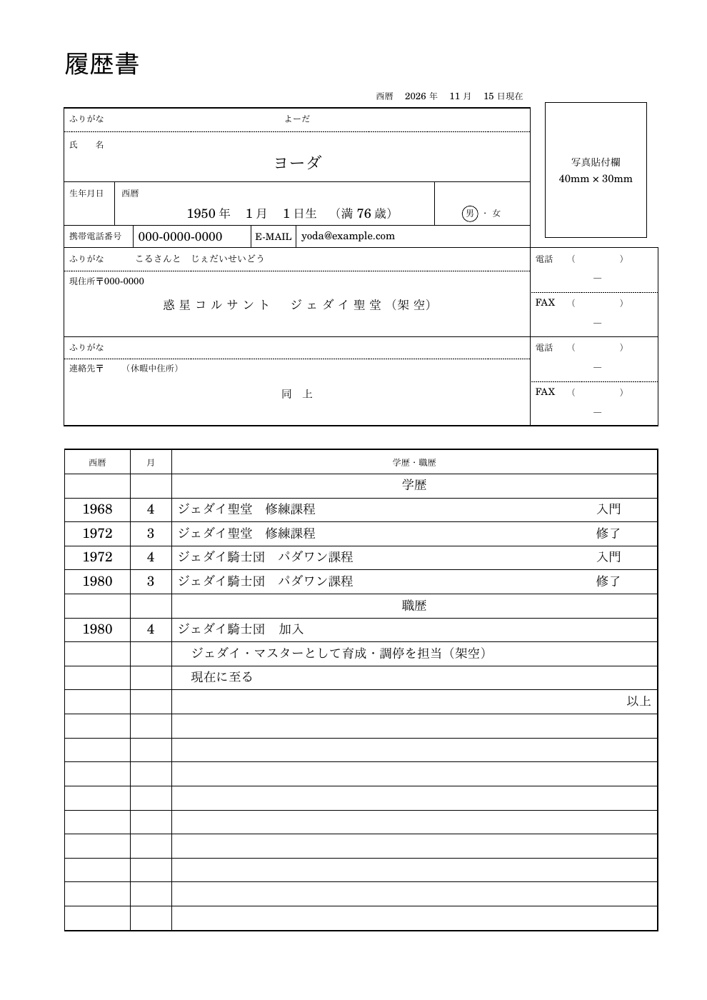
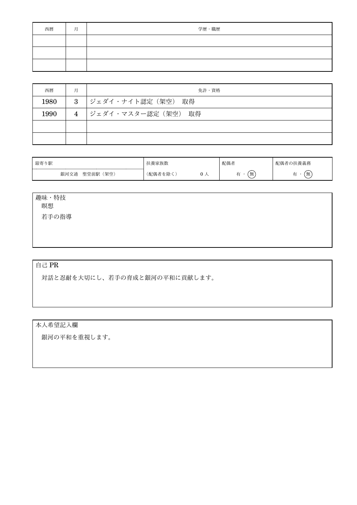
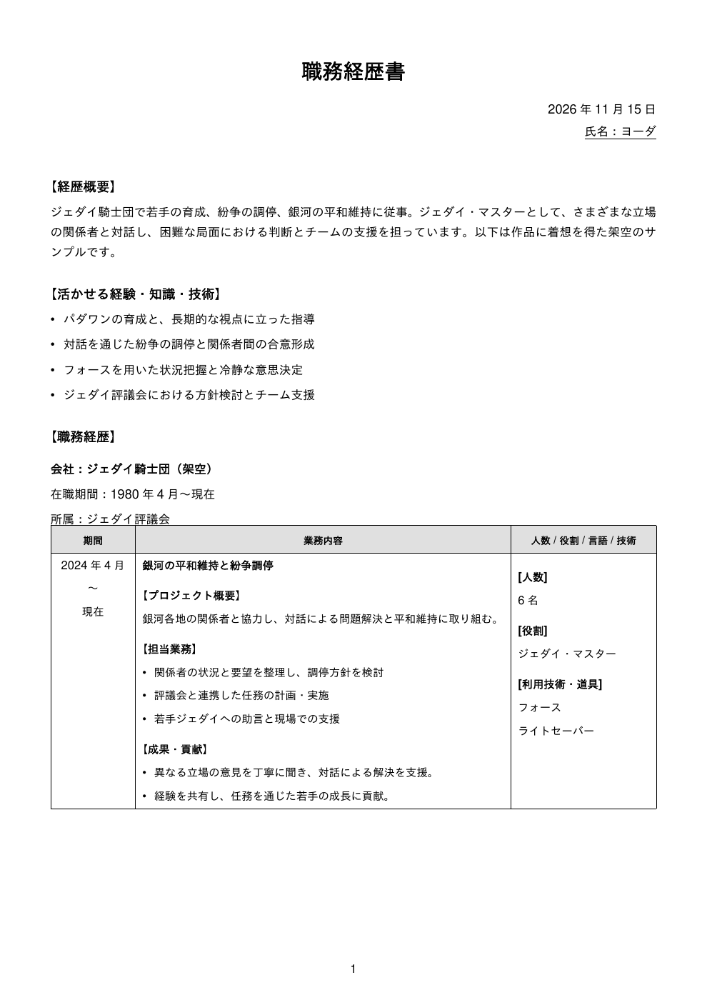
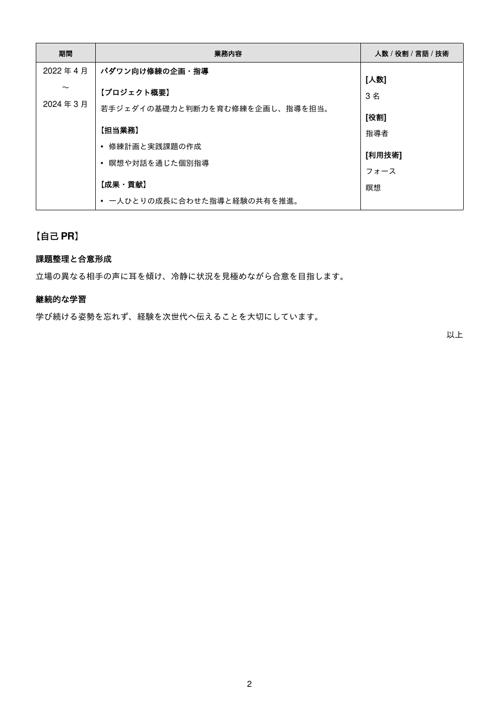

# 履歴書・職務経歴書

LuaLaTeXで編集・出力する、独立した2種類の書類です。本文データは各`.tex`、レイアウトは各`.sty`に分離しています。

## サンプル

以下は架空のデータを使ってビルドした出力例です。画像の日付・経歴はサンプル用です。

### 履歴書（A4・2ページ）

| 1ページ目 | 2ページ目 |
| --- | --- |
|  |  |

### 職務経歴書

| 1ページ目 | 2ページ目 |
| --- | --- |
|  |  |

職務経歴書は本文の量に応じてページ数が変わります。

## 構成

| ディレクトリ | 内容 | 編集ガイド |
| --- | --- | --- |
| `templates/resume/` | 匿名サンプル `resume.example.tex` と共通スタイル `resume.sty` | [履歴書](templates/resume/README.md) |
| `templates/career/` | 匿名サンプル `career.example.tex` と共通スタイル `career.sty` | [職務経歴書](templates/career/README.md) |
| `private/resume/` | 本番用 `resume.tex`、写真、生成PDF | Git管理外 |
| `private/career/` | 本番用 `career.tex`、生成PDF | Git管理外 |
| `references/` | ローカル専用の参照資料 | Git管理外 |

## ビルド

Dockerが利用できる環境で、プロジェクトルートから`mise`のタスクを実行します。初回またはDockerfileを変更したときはイメージを作成します。

```sh
mise run docker:build           # LaTeX用Dockerイメージを作成
mise run build                  # 匿名サンプルを両方ビルド
mise run build:resume           # 匿名サンプルの履歴書だけをビルド
mise run build:career           # 匿名サンプルの職務経歴書だけをビルド
mise run build:private          # 本番用を両方ビルド
mise run build:private:resume   # 本番用の履歴書だけをビルド
mise run build:private:career   # 本番用の職務経歴書だけをビルド
```

`build`と`rebuild`は匿名サンプル、`build:private`と`rebuild:private`は本番用のファイルを対象にします。日付はビルド日です。ソースに変更がない場合も、提出前には強制ビルドで日付を更新してください。

```sh
mise run rebuild                 # 匿名サンプルを両方強制ビルド
mise run rebuild:private         # 本番用を両方強制ビルド
mise run rebuild:private:resume  # 本番用の履歴書だけを強制ビルド
```

利用可能なタスクは`mise tasks`で確認できます。匿名サンプルの補助ファイルを削除するには`mise run clean`を使います。Dockerはプロジェクトルートをマウントし、生成PDFと補助ファイルをホスト上の各ディレクトリへ出力します。

ホストにLaTeXを直接インストールする場合のDebian/Ubuntuの依存パッケージ:

```sh
sudo apt install latexmk texlive-luatex texlive-lang-japanese texlive-pictures fonts-ipaexfont fonts-urw-base35
```

`mise`を使わずにDockerで本番用の履歴書をビルドする場合:

```sh
docker build -t resume-latex .
docker run --rm --user "$(id -u):$(id -g)" -e HOME=/tmp \
  -e TEXINPUTS=/work/templates/resume//: \
  -v "$PWD:/work" -w /work/private/resume \
  resume-latex latexmk -g -lualatex resume.tex
```

出力は`private/resume/resume.pdf`です。`TEXINPUTS`で本番用ソースから共通スタイルを参照します。職務経歴書は`TEXINPUTS=/work/templates/career//:`、`-w /work/private/career`、`career.tex`に変更します。サンプルをビルドする場合は`-w /work/templates/resume`と`resume.example.tex`（または`career`）を指定します。`.dockerignore`により、個人情報を含むファイルはイメージのビルドコンテキストに含めません。

`.gitignore`は個人情報と一時ファイルをGit管理から除外します。ビルド結果は各ディレクトリに残ります。

## 個人情報と本番書類

`private/`と`references/`は`.gitignore`で除外しています。本番用の`.tex`は対応する`templates/`内のスタイルを読み込みます。ローカルにLaTeXを導入している場合は、各本番用ディレクトリで`TEXINPUTS`を指定してビルドできます。

```sh
TEXINPUTS=../../templates/resume//: latexmk -g -lualatex resume.tex  # private/resume/ 内
TEXINPUTS=../../templates/career//: latexmk -g -lualatex career.tex  # private/career/ 内
```

公開前には、本番ファイルが除外されていることを確認してください。

```sh
git check-ignore -v private/resume/resume.tex private/resume/resume.pdf private/career/career.tex private/career/career.pdf
git status --short
```
